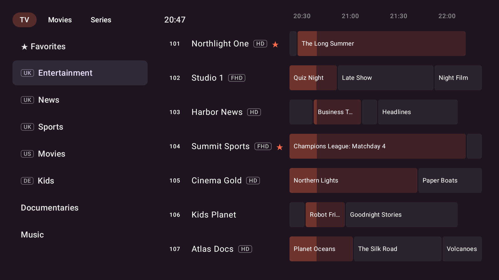
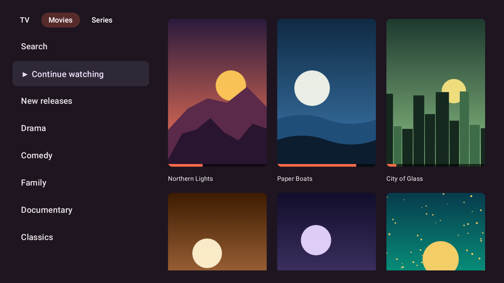
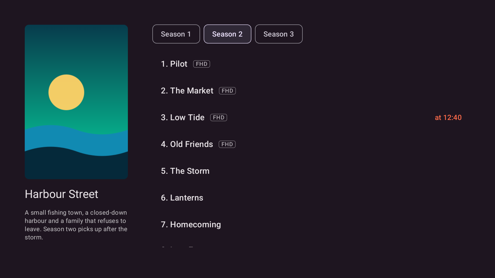
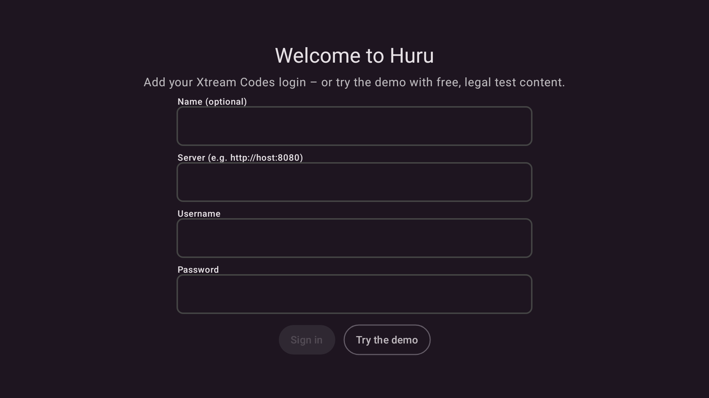
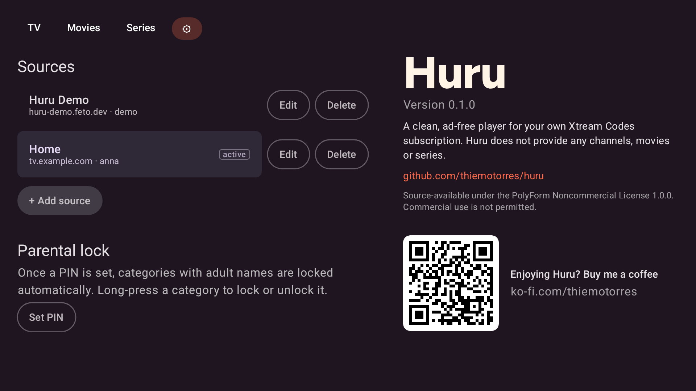

<p align="center"></p>

**Huru** is a clean, ad-free IPTV player for Amazon Fire TV (Android TV). It plays **your own** Xtream Codes subscription – no ads, no tracking, no clutter. *Huru* means "free" in Swahili.

https://github.com/user-attachments/assets/ce6b96bf-3270-40b1-a0a2-a3e2cd4b5fda


<p align="center"> </p>
<p align="center"> </p>
<p align="center"><sub>Screenshots use fictional channels and artwork.</sub></p>

**Try it:** choose **"Try the demo"** on the first screen – it connects to a demo server with legal content only (see [`demo-server/`](demo-server/)).

<p align="center"> </p>

> **Note:** Huru does not provide any channels, movies or series and does not point to any provider. You need your own, legitimate subscription.

## Features

- **Live TV** with a programme guide (EPG) built into the channel list, favourites and hideable categories
- **Fast zapping:** Up/Down in the player, starts straight into the last watched channel
- **Movies & series** as a poster grid with search, "Continue watching" and automatic next episode
- **Multiple sources:** add, edit and switch between Xtream logins; favourites and progress are kept per source
- **Built for the remote:** everything works with the D-pad; long-press OK for favourites or hiding categories

## Install

Download the latest `huru-<version>.apk` from [Releases](https://github.com/thiemotorres/huru/releases) and sideload it:

```sh
adb connect <fire-tv-ip>:5555               # enable ADB debugging in the developer options first
adb install -r huru-<version>.apk
```

## Build

Requirements: JDK 17, Android SDK (platform 35).

```sh
./gradlew testDebugUnitTest assembleRelease   # APK in app/build/outputs/apk/release/
```

Without a release keystore (`keystore.properties`, see `AGENTS.md`) the APK is signed with your debug key. `-Pstore=amazon` builds the Amazon Appstore variant.

## Tech

Kotlin, Jetpack Compose for TV, Media3 ExoPlayer, Coil. No other dependencies, no backend.

## Contributing & support

Contributions are welcome – please read [CONTRIBUTING.md](CONTRIBUTING.md) first. If Huru is useful to you, you can [buy me a coffee on Ko-fi](https://ko-fi.com/thiemotorres) ☕

## Brand

Logo, colours and usage rules: [`branding/BRAND.md`](branding/BRAND.md). Typeface in the logo: Figtree (SIL OFL 1.1).

## License

Huru is **source-available** under the [PolyForm Noncommercial License 1.0.0](LICENSE.md): you may use, study, modify and share it for any **noncommercial** purpose. Commercial use – including selling it, bundling it with a paid service or shipping it with ads – is not permitted. For commercial licensing, open an issue.

The name **Huru** and the Huru logo are not covered by this license; see [`branding/BRAND.md`](branding/BRAND.md#name-and-logo). Forks must use a different name and logo.
